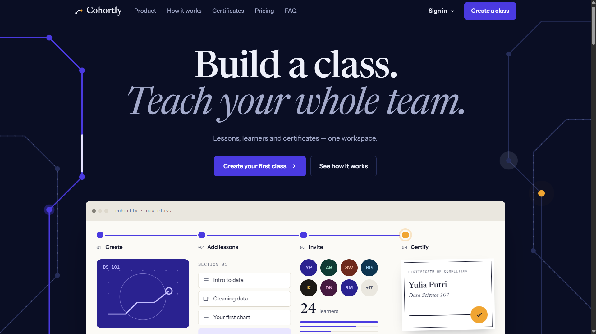
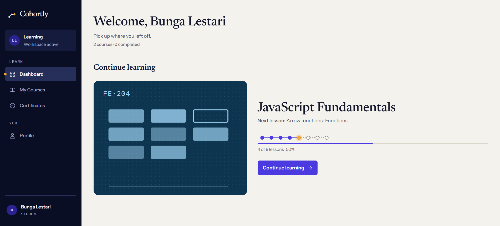
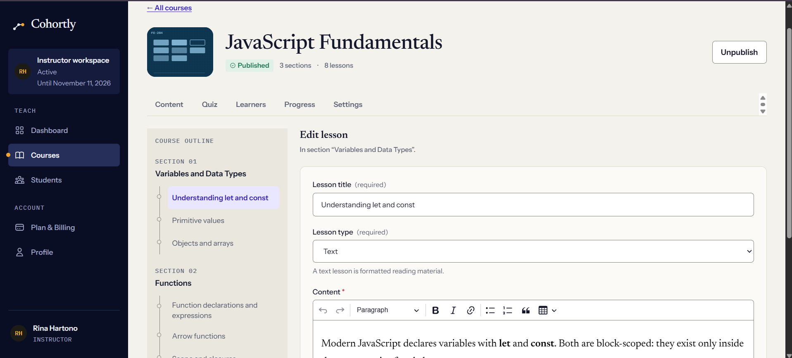
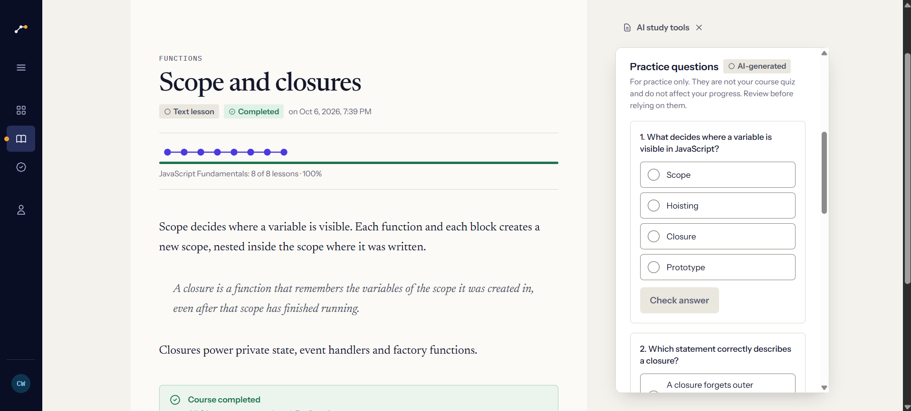
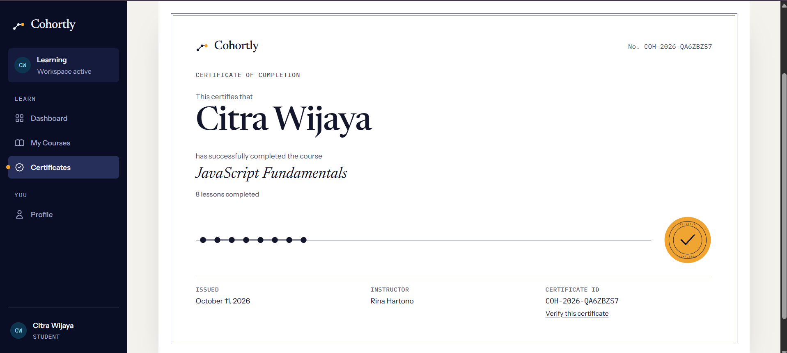
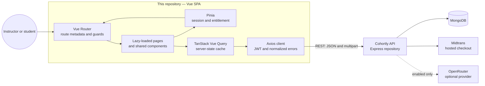

<p align="center">
  
</p>

<h1 align="center">Cohortly</h1>

<p align="center"><strong>Structured learning for your organization.</strong></p>

<p align="center">
  A role-aware learning workspace for building courses, guiding learners, tracking progress, and issuing verifiable certificates.
</p>

<p align="center">
  
  
  
  
</p>

<p align="center">
  <a href="https://github.com/Indo86/cohortly-frontend">Frontend repository</a>
  ·
  <a href="https://github.com/Indo86/cohortly-backend">Backend repository</a>
  ·
  <a href="https://github.com/Indo86/cohortly-backend#fresh-setup">Backend setup guide</a>
</p>


<p align="center">
  <a href="#project-preview">Preview</a> ·
  <a href="#overview">Overview</a> ·
  <a href="#key-features">Features</a> ·
  <a href="#tech-stack">Tech Stack</a> ·
  <a href="#system-architecture">Architecture</a> ·
  <a href="#getting-started">Getting Started</a> ·
  <a href="#project-structure">Structure</a> ·
  <a href="#engineering-highlights">Highlights</a>
</p>


##  Project preview

<table>
  <tr>
    <td colspan="2" align="center">
      <br>
      <sub><b>Landing page</b></sub>
    </td>
  </tr>
  <tr>
    <td width="50%" align="center">
      <br>
      <sub><b>Student dashboard</b></sub>
    </td>
    <td width="50%" align="center">
      <br>
      <sub><b>Course authoring</b></sub>
    </td>
  </tr>
  <tr>
    <td width="50%" align="center">
      <br>
      <sub><b>Optional AI study tools</b></sub>
    </td>
    <td width="50%" align="center">
      <br>
      <sub><b>Completion certificate</b></sub>
    </td>
  </tr>
</table>

##  Overview

Cohortly is a B2B learning management interface for instructors and students in the same organization. Instructors structure courses, manage learners, monitor progress, and maintain assessments; students receive a focused learning path with a clear next action, completion history, and certificates.

This repository contains the Vue 3 single-page application. Authentication, authorization, subscription access, progress calculations, quiz scoring, certificate issuance, payments, and optional AI generation remain authoritative in the separate [Cohortly backend](https://github.com/Indo86/cohortly-backend). The frontend is responsible for accessible interaction, navigation, server-state coordination, and truthful presentation of the API state.

##  Key features

- **Instructor workspace** — Create draft courses, organize sections and text or YouTube lessons, publish eligible courses, enroll students, and review learner progress.
- **Guided student experience** — Resume the backend-selected next lesson, navigate an ordered course outline, mark lessons complete or incomplete, and review completed material.
- **Assessments and credentials** — Configure one optional final quiz per course, record attempt history, require a passing result for completion, print certificates, and verify certificate IDs publicly.
- **Role and subscription boundaries** — Separate instructor and student routes, distinguish authentication from workspace entitlement, and preserve issued certificates when a workspace becomes inactive.
- **Hosted billing flow** — Start or renew a workspace through Midtrans without collecting payment-card data in the application.
- **Optional AI assistance** — Provide lesson summaries, grounded Q&A, practice questions, and instructor-reviewed quiz drafts when the backend reports AI as enabled and available. AI output does not alter progress or assessment results.

##  Tech stack

| Area | Technologies |
| --- | --- |
| Frontend | Vue 3 Composition API, JavaScript, Vue Router 5 |
| Client state | Pinia for session and entitlement state; TanStack Vue Query for server state |
| API layer | Axios with JWT injection, normalized errors, and centralized 401/403 policy |
| UI and content | Tailwind CSS 3, design tokens, CKEditor 5, responsive YouTube embeds |
| Testing and quality | Vitest, Vue Test Utils, jsdom, axe-core, ESLint |
| Build | Vite 8, PostCSS, Autoprefixer |
| Backend and database | Express 4, MongoDB, and Mongoose in a separate repository |
| External integrations | Midtrans hosted checkout; OpenRouter-backed AI when enabled by the backend |

##  System architecture



The application treats the API as the source of truth. Route guards use backend-provided identity and entitlement, Vue Query owns remote data, and mutations invalidate only the affected query branches. A session change clears the entire query cache so data cannot leak between users.

##  Engineering highlights

- **Authentication is separate from entitlement.** A valid user may still have an inactive workspace. A `401` clears the session, while entitlement-specific `403` responses keep the identity and route the user to billing or the inactive-workspace screen.
- **Progress and scoring are backend-authoritative.** The client never derives course completion, quiz scores, pass/fail state, or certificate eligibility. It renders the values and next activity returned by the API.
- **Server state is intentionally scoped.** Hierarchical query keys separate instructor and student data. Mutations use targeted invalidation, and reorder operations refetch instead of applying optimistic state when the server rejects stale IDs.
- **Sensitive integrations stay outside the browser.** Midtrans handles payment details on its hosted page, AI provider keys and prompts live in the backend, and the student quiz payload never receives an answer key before submission.
- **Accessibility is part of the application shell.** The interface includes skip links, route-change focus management, labelled controls, keyboard-safe dialogs and menus, reduced-motion behavior, semantic progress indicators, and automated axe checks.

##  Getting started

### Prerequisites

- Node.js `^20.19.0` or `>=22.12.0` (required by the installed Vite version)
- npm
- A running [Cohortly backend](https://github.com/Indo86/cohortly-backend) and MongoDB instance

Database configuration, schema models, seed data, Midtrans credentials, and optional AI provider settings belong to the backend repository; this frontend does not connect to MongoDB directly.

### Install

```bash
git clone https://github.com/Indo86/cohortly-frontend.git
cd cohortly-frontend
npm ci
cp .env.example .env
```

On PowerShell, use `Copy-Item .env.example .env` for the last command.

### Configure the environment

```dotenv
VITE_API_URL=http://localhost:3000
```

| Variable | Required | Purpose |
| --- | --- | --- |
| `VITE_API_URL` | Yes | Base URL of the Cohortly API. It must be a valid HTTP(S) URL. |

Variables prefixed with `VITE_` are included in the public browser bundle. Do not place secrets in them. The backend must also allow the frontend origin through its `FRONTEND_URL` or CORS configuration; the default development origin is `http://localhost:5173`.

### Run locally

```bash
npm run dev
```

Vite starts on `http://localhost:5173` and uses a strict port. For a populated local workspace, run `npm run seed:demo` from the backend repository after completing its setup.

### Build for production

```bash
npm run build
npm run preview
```

The production bundle is written to `dist/`; the preview server also uses port `5173`.

##  Testing

```bash
npm run lint
npm test
npm run build
```

Vitest runs unit and component tests in jsdom. The suite exercises route guards, session and HTTP policies, instructor and student workflows, billing, quizzes, certificates, optional AI states, cache invalidation, and accessibility. API behavior is supplied by in-memory Axios adapters and stateful test backends, so the test suite does not contact a real API or AI provider.

For active development, use `npm run test:watch`. This repository currently has no committed end-to-end suite or CI workflow.

##  Project structure

```text
.
├── public/                 # Cohortly mark and static assets
├── src/
│   ├── components/         # UI primitives and domain components
│   ├── composables/        # Vue Query reads, mutations, and shared behavior
│   ├── constants/          # Product identity, roles, routes, and statuses
│   ├── design/             # Design-token source
│   ├── layouts/            # Public, instructor, and student shells
│   ├── pages/              # Lazy-loaded route views
│   ├── router/             # Routes, guards, titles, and focus handling
│   ├── services/           # API clients, endpoint modules, and HTTP policy
│   ├── stores/             # Pinia session and entitlement state
│   └── utils/              # Navigation, validation, content, and date helpers
├── tests/                  # Vitest suites and in-memory API fixtures
├── .env.example            # Public frontend configuration template
└── vite.config.js          # Build, aliases, and test configuration
```

##  Related documentation

- [Backend setup and domain documentation](https://github.com/Indo86/cohortly-backend#readme)
- [Demo scenarios and seeded workflows](https://github.com/Indo86/cohortly-backend/blob/main/docs/demo-scenarios.md)
- [Frontend environment template](./.env.example)
